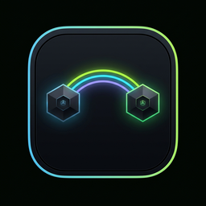
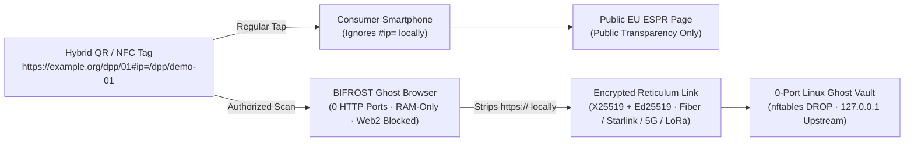

<p align="center">
  
</p>

<h1 align="center">BIFROST</h1>
<p align="center"><strong>Zero-IP Ghost Browser · Powered by Reticulum</strong></p>
<p align="center">
  <em>“Verifiable Credentials protect the passport. Chrome leaks the mission.”</em>
</p>
<p align="center">
  <code>v0.1.0-preview (Experimental Developer Preview)</code> &nbsp;·&nbsp; <code>bifrost://</code> &nbsp;·&nbsp; <code>ironpass://</code> &nbsp;·&nbsp; <strong>0 Local HTTP Ports</strong> &nbsp;·&nbsp; <strong>Clean-Room Rust</strong>
</p>

> [!NOTE]
> **Scope & Status (`v0.1.0-preview` — Experimental Developer Preview):**
> **BIFROST** is an **application-layer HTTP/DPP Ghost Browser** built on top of [`citadel-rns-rs`](https://github.com/whattio/citadel-rns-rs) and the MIT Rust `Reticulum-rs` library. It is **not** a full Reticulum protocol implementation and does not replace Mark Qvist's authoritative Python Reference Implementation ([markqvist/Reticulum](https://github.com/markqvist/Reticulum)). Full wire-level interoperability testing against the official Python `RNS` reference node (and optional support for community-recognized **Quad4 `Reticulum-Go`**) is on the active engineering roadmap. BIFROST is built strictly for **EU ESPR / CIRPASS-2 Digital Product Passports, critical-infrastructure resilience, and defensive sovereign privacy** (non-weaponized).

---

## What Is BIFROST?

**BIFROST** (*The Reticulum Ghost Browser*) is **not** a replacement for Chrome. It is an experimental, human-reviewed **5 MB Sovereign Zero-IP Client** built in Rust (`wry` + `tao` + [`citadel-rns-rs`](https://github.com/whattio/citadel-rns-rs)) that closes **“The Last-Meter Leak”** in **CIRPASS-2**, **EU ESPR Digital Product Passports**, and private sovereign infrastructure:

- **Zero Local HTTP Ports:** Embeds `citadel-rns-rs` directly in-process — zero localhost web proxy sockets (`ss -tlnp` shows no listening HTTP servers).
- **Zero Web2 / DNS Egress:** Hard-blocks `http://` and `https://` navigation by default. All traffic rides over encrypted **512-bit Curve25519 (X25519 ECDH + Ed25519)** Reticulum links across any untrusted physical pipe (Fiber, Starlink, 5G, Wi-Fi, or Sub-GHz LoRa).
- **RAM-Only Ephemeral Sessions:** Runs in incognito mode with an in-memory `localStorage`/`sessionStorage` shim — zero cookies, zero history, and zero cache written to SSD.
- **Local Rust Ed25519 + GS1 EPCIS 2.0 Verification:** Opens pure `~1.7 KB` signed JSON passports over `ironpass://`, verifies both the canonical **SHA-256 + RFC 8032 Ed25519** signature and the entire hash-chained **IronPass Ledger** locally via `ed25519-dalek` in **~30 ms** — never trusting remote JavaScript.
- **Hybrid Tag (`#ip=`) Dual-Tier Support:** Consumers tap an NFC/QR tag with any normal phone for the public EU ESPR passport (zero app needed); authorized operators scan the exact same tag in **BIFROST** to strip Web2 locally and unlock the classified vault & EPCIS ledger over Reticulum.
- **Optional Local Sovereign AI Omnibox:** Connect your own local OpenAI-compatible NPU / Ollama / `llama.cpp` server (e.g. Qualcomm Ventuno Q 40 TOPS NPU) over Reticulum for zero-cloud AI queries directly from `bifrost://home/`.

---

## Executive Contrast: CIRPASS-2 in Chrome vs. BIFROST

| Layer | Standard Web2 DPP (CIRPASS-2 in Chrome) | BIFROST (`bifrost://` & `ironpass://`) |
| :--- | :--- | :--- |
| **Compliance / Schema** | EU ESPR, W3C VC, GS1 EPCIS 2.0 | **100% compatible** (identical EU ESPR & GS1 EPCIS 2.0 JSON) |
| **Network Exposure** | Public IP + DNS + open `:443` + Cloud CDN | **0 open server ports · 0 local HTTP sockets · 0 DNS · 0 cloud** |
| **Browser Footprint** | Cookies, SSD history/cache, extensions, telemetry | **RAM-only ephemeral session · Web2 (`http`/`https`) hard-blocked** |
| **Verification** | JavaScript downloaded from the web server | **Local Clean-Room Rust (`ed25519-dalek` + `sha2` + NTAG 424 DNA)** |
| **Payload & Resilience** | Heavy web app — fails when internet/cloud is down | **Pure ~1.7 KB signed JSON** — Fiber, Starlink, 5G & 1.7 kbps Sub-GHz LoRa |
| **Consumer UX** | Regular phone tap | **Hybrid Tag (`#ip=`)**: zero-app consumer tap + classified Ghost operator tier |

---

## Architecture Overview



---

## Quickstart (Ubuntu, Debian & Raspberry Pi 64-bit)

### Option 1 — Install via `.deb` Package (Recommended, 2 seconds)
Download the latest `amd64` (x86_64 PCs) or `arm64` (Qualcomm Ventuno Q & 64-bit Raspberry Pi 4/5) `.deb` from **Releases** (or build locally with `./packaging/build-deb.sh`):
```bash
# x86_64 Ubuntu / Debian:
sudo apt install ./bifrost-ghost-browser_0.1.0_amd64.deb

# ARM64 (Ventuno Q & 64-bit Raspberry Pi OS / Debian Bookworm):
./scripts/install-debian-pi.sh --deb ./bifrost-ghost-browser_0.1.0_arm64.deb
```

### Option 2 — One-Command Build & Install Script
Installs GTK/WebKit2GTK dev headers, compiles **BIFROST**, installs the binary + desktop icon, and registers `bifrost://` and `ironpass://` URI handlers:
```bash
git clone https://github.com/whattio/bifrost.git
cd bifrost

# Ubuntu 24.04 (x86_64 or arm64 / Ventuno Q):
./scripts/install-ubuntu.sh

# Debian 12/13 & 64-bit Raspberry Pi OS (auto-handles low-RAM & Pi GPU KMS):
./scripts/install-debian-pi.sh
```

### Option 3 — Instant Built-In Local Showcase (Zero Setup!)
BIFROST ships with **zero central servers and zero hardcoded remote hosts**. The moment you open BIFROST, you can test the entire sovereign experience completely offline using the built-in local showcase:
- **`bifrost://home/showcase`** — Self-contained readable BIFROST / CITADEL / IRONPASS example microsite
- **`ironpass://local-demo/dpp/battery-01`** — Live **EU Battery Passport 2027** with real Rust **Ed25519 signature verification**, **Hybrid `#ip=` QR tags**, and an interactive **hash-chained GS1 EPCIS 2.0 IronPass Ledger** (seal new signed events live in RAM!)
- **`ironpass://local-demo/dpp/drone-01`** & **`ironpass://local-demo/dpp/furniture-01`** — Aerospace MRO & EU ESPR circularity examples

### Option 4 — 60-Second Self-Hosted 0-Port Reticulum Vault
Ready to test live encrypted Reticulum networking between two processes or two Linux hosts? Run the included localhost-only demo vault (`127.0.0.1:8080`, 0 external ports):

1. **Terminal 1 — Start the localhost-only demo vault (`127.0.0.1:8080`, 0 external ports):**
   ```bash
   python3 examples/demo-vault/server.py
   ```
2. **Terminal 2 — Expose it strictly over encrypted Reticulum (`citadel-rns-rs`):**
   ```bash
   cargo install --git https://github.com/whattio/citadel-rns-rs.git --bin citadel-vault-daemon
   citadel-vault-daemon --identity-name my-demo-vault --upstream http://127.0.0.1:8080 --rns-peer 127.0.0.1:14290
   ```
3. **Terminal 3 — Launch BIFROST:**
   ```bash
   bifrost-ghost-browser --rns-listen 127.0.0.1:14290
   ```
   Open **📡 NODES** inside BIFROST — click **OPEN GHOST SITE** (`bifrost://<hash>/`) or **OPEN DEMO DPP + LEDGER** (`ironpass://<hash>/dpp/demo-01`), then seal a new Ed25519-signed GS1 EPCIS 2.0 event live!

---

## Operator Bookmarks & Local Sovereign AI (Optional)
- **Private Bookmarks (`~/.config/bifrost/bookmarks.json`):** Add your own node shortcuts locally without ever committing hashes to source control:
  ```json
  [
    { "label": "My Ghost Vault", "icon": "🔒", "uri": "bifrost://<32-hex-hash>/", "tone": "holo" },
    { "label": "Battery DPP", "icon": "📜", "uri": "ironpass://<32-hex-hash>/dpp/demo-01", "tone": "amber" }
  ]
  ```
- **Local AI Omnibox (Ollama / `llama.cpp` / Ventuno Q):** Run `citadel-vault-daemon --upstream http://127.0.0.1:11434 --rns-peer <BIFROST_IP>:14290` (or port `8090` for `llama-server`), place any optional Bearer token in `~/.config/bifrost/llm_api_key` (`chmod 600`), and launch with `--llm-hash <hash> --llm-model <model>`.

---

## Part of the Free & Open-Source `whatt.io` DPP Ecosystem
**BIFROST** is the Zero-IP sovereign browser track within the broader **[whatt.io Open-Source DPP Ecosystem](https://github.com/whattio)** — where we are publishing a growing suite of **free and open-source tools and web apps for standard Digital Product Passports (EU ESPR, CIRPASS-2, REACH/SVHC, CRMA, GS1 Digital Link, EPCIS 2.0 & PCM)**, available free at [whattio.app](https://whattio.app), self-hosted via Docker, and open source on [github.com/whattio](https://github.com/whattio).

## Documentation
- [**Architecture & Zero-Port Threat Model**](docs/ARCHITECTURE.md)
- [**Hybrid `#ip=` Tags & IronPass Ledger (GS1 EPCIS 2.0) Specification**](docs/HYBRID_TAGS_AND_LEDGER.md)
- [**Hosting a 0-Port Ghost Web & DPP Server**](docs/HOSTING_A_GHOST_SERVER.md)
- [**Cross-Platform Roadmap (Linux, macOS, Windows & Mobile)**](docs/CROSS_PLATFORM.md)
- [**Security Policy**](SECURITY.md)

---

## Licensing, Attribution & Trademarks
- **Source Code:** Dual-licensed under [**GNU AGPLv3 (`AGPL-3.0-or-later`)**](LICENSE) or a [**Commercial License**](COMMERCIAL-LICENSE.md) for OEM, white-label, or closed-source redistribution.
- **Wire Protocol Attribution:** Built on the **Public Domain Reticulum Wire Protocol** invented by **Mark Qvist** (<https://reticulum.network>), using clean-room MIT Rust crates (`citadel-rns-rs`) — see [**NOTICE**](NOTICE).
- **Trademarks & Icons:** `BIFROST`, `CITADEL`, `IRONPASS`, `ASGAARD`, and all icons in `assets/` are protected — see [**TRADEMARKS.md**](TRADEMARKS.md).
